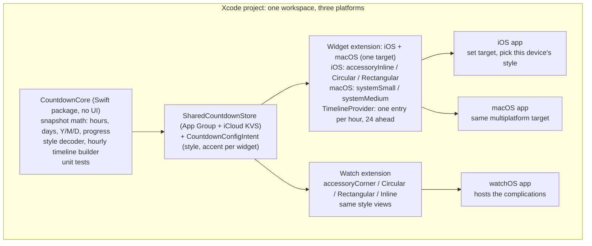

# Countdown Widget — Spec (ratified 2026-11-08)

**Status:** Frozen. Per project convention, this spec is immutable. Changes are recorded in the plan (`docs/plans/`), never edited into this file.
**Owner:** Marty Gleason
**Workflow:** Chat-first, propose-then-ratify. Claude Code plans and implements one phase at a time; Marty builds in Xcode and reports each gate before the next phase starts. No fire-and-forget scaling.

---

## 1. Why

A glanceable countdown to one moment about four years out, visible on the iPhone lock screen, the Mac desktop, and the Apple Watch without opening an app. The prime example: **retirement, counted in hours.** Set the target once; every device shows it, each in its own UI (style and accent chosen per device).

**Vision sentence:** one tap-free number that answers "how long until then?" everywhere you look.

## 2. What (v1 scope)

One Xcode project, three platforms, one shared countdown core.

| Surface | Widget families | Shows |
| --- | --- | --- |
| iOS Lock Screen | accessoryInline, accessoryCircular, accessoryRectangular | Inline: `34,872 h · Label`. Circular: big number. Rectangular: label + number on two lines |
| macOS Desktop / Notification Center | systemSmall, systemMedium | Label, number stacked, target date in small type |
| watchOS complication | accessoryCorner, accessoryCircular, accessoryRectangular, accessoryInline | Same as iOS accessory, plus corner gauge text |

### Configuration

- **Shared (set once, synced by iCloud):** target instant (date + time), label, count-up-after-target on/off, optional start date (unlocks Ring and Bar styles).
- **Per device / per widget (long-press → Edit Widget):** style (default Hours), accent (system tint or ~6 curated colors).

### Shared across devices

The target lives in one `SharedCountdownStore`: an App Group `UserDefaults` that the widgets read, mirrored to `NSUbiquitousKeyValueStore` (iCloud key-value store) so iPhone, Mac and Watch agree. Each host app listens for iCloud changes, writes them to the App Group, and calls `WidgetCenter.reloadAllTimelines()`. Only target, label, count-up flag and start date sync. Style and accent are per device, so the Watch can show Hours while the Mac shows Stacked.

### Host apps

Minimal. Each shows the countdown, lets you set the shared target, and picks this device's style. They exist because WidgetKit requires a containing app per platform.

### Out of scope for v1

Multiple simultaneous countdowns, iOS Home Screen system families, notifications at milestones, seconds-level ticking.

## 3. Design: Liquid Glass, multiple styles

The system supplies the glass; we supply disciplined content. On iOS 26 / macOS 26 / watchOS 26 the widget container, lock-screen vibrancy and desktop glass are rendered by WidgetKit. Our job is typography, hierarchy, accent, and legibility in every rendering mode (full color, accented, vibrant).

### Design rules

- `containerBackground(for: .widget)` always; never paint our own background.
- Mark the number and accent elements with `widgetAccentable()` so tinted Home/Lock Screens recolor them, not the label.
- SF Pro Rounded for the big number, monospaced digits so layout does not jitter on refresh.
- Test every style in all three rendering modes and in Dynamic Type up to the largest accessibility size that family supports.
- Depth comes from the system material, not from shadows or gradients we add.
- Verify current Liquid Glass widget APIs against Apple's docs at the start of Phase 2; do not rely on memory.

### Styles as data (ratified)

Styles must be something a designer can add **without writing Swift**. Each style is a bundled `styles/<name>.json` file decoded into `CountdownStyle`:

- `typography`: text style, weight, rounded (bool), monospacedDigits (bool)
- `unit`: `hours` | `days` | `ymd` | `sentence`
- `arrangement`: `stacked` | `inline` | `ring` | `bar` | `milestone`
- `accentRole`: which element takes the accent
- `numberFormat`: grouping, abbreviation rules
- `families`: optional per-family overrides and a fallback style name for families that cannot fit this arrangement

One generic SwiftUI renderer draws any style. Adding a style = adding a JSON file plus a preview screenshot.

### Initial styles

| Style | Reads as | Best on |
| --- | --- | --- |
| Hours (default) | `34,872` with "hours" beneath; updates every hour | Circular, Corner, Rectangular, systemSmall |
| Stacked | `3` years / `11` months / `27` days, three rows | Rectangular, systemSmall |
| Sentence | "3 years, 11 months, 27 days" one line | Inline, systemMedium |
| Days | `1,461` with "days" beneath | Circular, Corner |
| Ring | progress since start date around the hours-left number | Circular, systemSmall |
| Bar | thin progress bar under the number | Rectangular, systemMedium |
| Milestone | next round number: "30,000 hours in 4,872 hours" | systemMedium |

Styles a family cannot fit fall back to the nearest one (e.g. Milestone on Circular falls back to Hours).

## 4. Architecture

Everything that can be wrong lives in `CountdownCore` and is unit-tested; the extensions only map a `CountdownSnapshot` to a style view per family. iOS and macOS widgets are one extension target with `#if os` branches only around family lists.

## 5. Date math rules

The target is an **instant** (date + time, stored as UTC), so hours are exact: `hours = floor((target - now) / 3600)`. Years/months/days use `Calendar.current.dateComponents([.year, .month, .day], from: now, to: target)` in the device's current zone.

| Case | Rule | Test |
| --- | --- | --- |
| Hours | Floor of elapsed seconds / 3600; never round up | Target June 30 2030 17:00 CT; check ±1 s around an hour boundary |
| Leap day | Calendar handles it; Feb 29 2028 is inside the window | Nov 8 2026 → Nov 8 2030 = 4y 0m 0d, 1,461 days |
| Month-end rollover | Components, never 30-day months | Jan 31 → Mar 1 = 1m 1d (non-leap) |
| Target reached | "Now" within the target hour; afterwards count **up** in muted accent if the shared flag is on, else a static done state | Target −1 h, target, target +1 h, both flag values |
| Time zone change | Hours are zone-independent; Y/M/D recompute in the current zone | Chicago → Tokyo at 23:00 |
| DST | Instant math is DST-safe; never add 86,400-second days for Y/M/D | Mar 8 and Nov 1 boundaries |
| Timeline | One entry at each top-of-hour, 24 ahead, `.atEnd` reload; inside WidgetKit's daily refresh budget | Entry dates strictly increasing, all on the hour |
| Sync | iCloud KVS change → App Group write → reload timelines; widgets read App Group only | Change target on Mac; iPhone widget updates within a minute of the app running |

## 6. Ratified decisions

| Fork | Decision |
| --- | --- |
| Target instant | **June 30, 2030, 17:00 America/Chicago** (end of last working day) |
| Minimum OS | iOS 26 / macOS 26 / watchOS 26 |
| Signing | Apple Developer Program (paid) — required for iCloud KVS and App Groups |
| Repo home | New standalone repo, governed by turing-review (`code-process-review`) conventions; CLAUDE.md scaffolded via the cc-md skill |
| Sync | iCloud key-value store + App Group |
| Count-up after target | User-configurable; shared, synced setting beside target and label |
| Styles | Data-defined JSON theme files; seven initial styles, Hours default |
| Workflow | Chat-first; Claude writes and compile-checks Swift, Marty builds in Xcode and reports each gate |

## 7. Build plan

Each phase is one PR-sized chunk. Nothing scales past Phase 1 until the core's shape is ratified.

| Phase | Work | Gate (Marty ticks before next phase) |
| --- | --- | --- |
| 0 — Ratify spec | Done 2026-11-08 | ✅ |
| 1 — CountdownCore package | Repo scaffold + CLAUDE.md via cc-md; snapshot math (hours, days, Y/M/D, progress); style JSON decoder; hourly timeline builder; tests | Tests green, including hour-boundary, leap-day and DST cases |
| 2 — iOS + macOS widget | Extension + host app; SharedCountdownStore with iCloud KVS; intent config (style, accent); Hours / Stacked / Days styles | Renders on iPhone and Mac in all three rendering modes; target set on one device appears on the other |
| 3 — watchOS complications | Watch app + extension reusing the same views and provider | Complication live on a watch face |
| 4 — Styles and polish | Sentence / Ring / Bar / Milestone JSON styles; accent picker; count-up state; Dynamic Type | Largest Dynamic Type and VoiceOver pass |
| 5 — Install for the long haul | Signed with paid program, installed on every device, configured once | Still running after 8 days (past free-ID expiry window) |

## 8. Open dependency

The turing-review / `code-process-review` repo was not visible to the chat session. Before Phase 1, vendor its `conventions.md` into this repo and scaffold CLAUDE.md from it. If the repo is unavailable, flag it in the plan and proceed with the cc-md defaults.

## 9. Requirements

Added once before the first commit, under register `D15`. Each row restates a section above; no other words in this file were changed.

| ID | Requirement | Spec |
|---|---|---|
| FR1 | iOS Lock Screen: accessoryInline, Circular, Rectangular | §2 |
| FR2 | macOS: systemSmall, systemMedium | §2 |
| FR3 | watchOS: accessoryCorner, Circular, Rectangular, Inline | §2 |
| FR4 | Shared target, label, count-up flag and start date, set once and synced by iCloud KVS + App Group | §2 |
| FR5 | Per-widget style and accent via Edit Widget | §2 |
| FR6 | Hours = floor((target − now) / 3600), never rounded up | §5 |
| FR7 | Y/M/D from Calendar components in the current zone | §5 |
| FR8 | Target reached: Now, then count-up if the flag is on, else a done state | §5 |
| FR9 | Styles are bundled JSON drawn by one renderer, with per-family fallback | §3 |
| FR10 | Seven initial styles; Hours is the default | §3 |
| FR11 | Timeline: hourly entries, 24 ahead, `.atEnd` | §5 |
| FR12 | A host app per platform: show the countdown, set the target, pick the device style | §2 |
| NFR1 | Minimum iOS 26 / macOS 26 / watchOS 26 | §6 |
| NFR2 | Legible in full color, accented and vibrant, at the largest Dynamic Type, with VoiceOver | §3, §7 |
| NFR3 | System container background; monospaced digits; no added shadows or gradients | §3 |
| NFR4 | A change appears on another device within a minute of its app running | §5 |
| NFR5 | Keeps working on every device until 2030-06-30 | §1, §7 |

## Stack

- language: Swift 6.4
- framework: SwiftUI, WidgetKit, AppIntents
- runner: swift test (Swift Testing), xcodebuild for app targets
- layout: one Xcode project + local package CountdownCore/
- ci: GitHub Actions macOS runner

-----
2026-11-08

#AI/Claude
